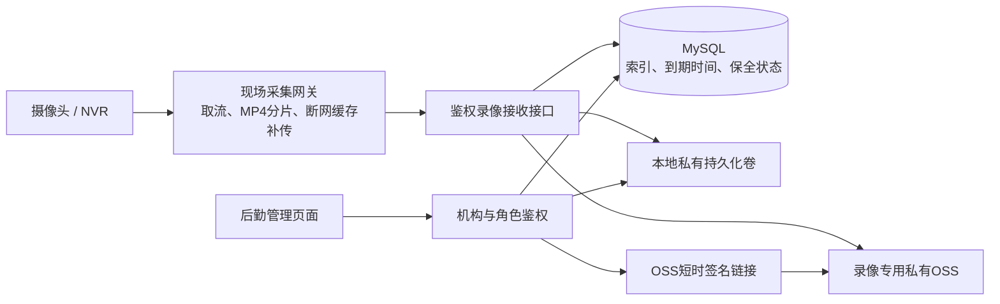

# 消防安全摄像头录像管理

## 1. 交付范围

入口：消防安全管理 → 摄像头录像管理（`/fire/video`）。后勤菜单、岗位导航及工作台不再展示录像入口；旧地址`/logistics/video`保留跳转，兼容原书签与页面授权。后端接口及录像数据保持兼容。

已实现管理页面、数据库、接口与私有分片存储。支持摄像头登记、停用、分片接收状态、录像导入、时间范围检索、回放、事件保全、存储选型、容量估算及到期自动清理。

本系统作为管理平台和录像分片接收端；摄像头/NVR的持续取流、转封装、设备发现、断网缓存补传由现场采集网关负责。本次没有虚构常驻采集进程、在线设备或示例录像。选择 RTSP/ONVIF/GB28181/NVR 只登记现场接入方式，不代表平台已经具备这些协议的取流适配器。

默认策略：存储方式“暂未确定”、至少90天、自动清理关闭。未确定存储时可以登记设备，不能接收分片。选择存储不等于验证存储读写成功；需要导入和回放一个真实分片验收。

## 2. 使用流程

1. 登记摄像头编码、名称、公共区域位置、现场协议、网关通道标识、责任人和预计录像码率。不在管理页面保存摄像头密码或带凭据的流地址。
2. 在“存储与留存策略”选择本地或阿里云OSS；尚未选型可以继续保留“暂未确定”。填写机构适用的留存依据。
3. 部署人员配置私有存储，本地需独立持久化卷，OSS需独立私有Bucket。
4. 使用“导入录像分片”验证存储及回放；正式接入由现场网关持续推送分片。
5. 查阅录像：从摄像头档案点击“查看录像”，或按摄像头ID、时间和保全状态筛选。时间筛选按分片与查询区间相交，包含跨边界的分片。
6. 对事故相关的分片立即“事件保全”，填写原因；调查完成后“解除保全”，同样记录原因。解除时提示已到期录像可能被下一轮清理。
7. 验收后按机构制度开启自动清理；不开启时持续积累文件，需要运维监测空间。

### 页面状态含义

| 显示状态 | 判定 | 后续处理 |
| --- | --- | --- |
| 待接入 | 启用但从未收到有效分片 | 检查网关、通道与存储配置 |
| 最近收到分片 | 最近一个可用分片结束时间在15分钟以内 | 仅说明接收情况，不能证明无断录或90天完整 |
| 超过15分钟未收到录像 | 曾收到分片，但最近分片已过15分钟 | 排查设备、网关、网络和存储；支持从档案定位责任人 |
| 已停用 | 人工停用接收 | 不接收新分片，保留历史录像，不远程关闭物理设备 |

当前为页面风险提示，需点击“刷新状态”重新核对；未实现短信、电话或OA自动派单，也未将索引状态解释为物理摄像头在线状态。

## 3. 90天留存与安全删除

- 后端和前端均限制90～3650天；90天是本次机构需求底线，不能通过直接调用接口缩短到90天以内。
- 每片记录起止时间、SHA-256、实际字节数、存储位置、到期时间和保全状态。
- 到期时间按分片结束时间加保留天数计算，避免分片尾部不足90天。
- 延长策略通过数据库同时延长所有可用历史分片。缩短策略保留既有分片原先已承诺的到期时间。
- 自动清理默认关闭；开启后每分钟最多处理每机构100片，负载更大时应按实际分片速率扩展清理吞吐并监测积压。
- 清理条件同时满足：未保全、状态可用、已到期、结束时间已超过当前留存天数且至少90天。
- 保全与清理对同一录像行加锁，防止保全和删除竞态；延长策略与清理通过机构策略行锁协调。
- 清理先删除物理文件，再写“已清理”状态，保留索引和审计。失败抛错并写服务日志，后续定时重试；物理文件已删但数据库事务失败时可幂等重试，期间可能暂时显示文件缺失。
- 磁盘空间不足时写入失败，不提前覆盖90天内录像。需要网关独立缓存、磁盘告警和补传。
- 不提供普通手工删除入口；保全录像需有解除依据，不能永久无目的保留。保全解除后的清理继续遵循原到期规则。

## 4. 两种存储方案



| 维度 | 本地专用存储 | 阿里云OSS |
| --- | --- | --- |
| 适用条件 | 已有NVR/磁盘阵列、上行带宽有限 | 上行稳定，需要云端弹性容量 |
| 落地方式 | 网关推送到平台私有卷；已有NVR原始录像不会自动被平台索引 | 同一接收接口将分片写入私有Bucket |
| 维护重点 | 可用容量、磁盘健康、UPS、备份和数据库一致性 | 上行带宽、网关缓存、权限、容量和回放费用 |
| 回放 | 后端鉴权读取，本页面以Blob播放短分片 | 后端鉴权后签发5分钟有效URL |
| 成本项 | 磁盘、冗余、服务器、运维和供电 | 存储、请求、读取/取回与外网流量，按实际计费模型核价 |
| 故障能力 | 依赖平台与磁盘；RAID不等于备份 | 断网时仍依赖网关缓存，不能自动保证连续录像 |

业务不绑定最终选型：每片记录自己的LOCAL/OSS位置。变更策略只改变新分片去向，旧分片继续从原位置回放和清理。当前每种provider只有一个部署级存储位置；在旧录像清理前不要直接更换本地根目录或OSS Bucket/Endpoint，迁移需单独执行文件校验和索引更新。

本次不做双写、历史批量迁移、智能识别、人脸搜索或厂商专有SDK，以免在设备和选型未知时引入不必要依赖。

### 容量计算

十进制TB，24小时连续录像：

`所需TB ≈ 启用摄像头总码率(Mbps) × 86400 × 保留天数 ÷ 8,000,000 × 1.2`

例如32路、每路2Mbps、90天：原始约62.208 TB，含20%余量约74.65 TB；持续上传净码率64Mbps，链路还需考虑协议开销和补传峰值。以上为算术示例，不是项目现场设备数量或采购报价。RAID损耗、备份副本和事件保全另计；最终以实测码率、可用容量与费用预算验收。

## 5. 权限及隐私

| 操作 | 后勤员工 | 后勤部长 / 院长 / 管理员 |
| --- | --- | --- |
| 摄像头档案与接收风险、策略查看 | 可 | 可 |
| 编辑摄像头、修改策略 | 不可 | 可 |
| 导入、查询与回放录像 | 不可 | 可 |
| 保全与解除保全 | 不可 | 可，原因必填 |

所有接口强制机构上下文；即使系统管理员缺少机构上下文也拒绝访问，跨机构ID不能读取或修改录像。回放、导入、保全、解除、策略修改、摄像头编辑和清理写入现有审计日志。

录像不进入已有公开`/uploads/**`，不复用附件公共URL，不向浏览器返回存储objectKey或云凭据。OSS上传前检查Bucket私有权限，并将Object ACL显式设为Private；本地内容接口需要登录和管理角色，返回`Cache-Control: no-store`。SHA-256可用于文件对账，但不能单独证明采集源真实性。

播放属于受控查阅，不提供对外分享和家属端入口。浏览器“禁止下载”按钮只是界面限制，授权用户仍能获取所播放内容；不得将它当作防泄露措施。正式运行需HTTPS、账号授权和查阅制度。

## 6. 部署与接入契约

### 本地

`app.logistics.video.local-root`：开发默认`${user.home}/smartcare-video-private`，生产默认`/app/video-private`。Docker Compose已挂载`./output/video-private:/app/video-private`，与公开附件卷隔离并加入Git忽略。不要把此目录放进任何静态站点根目录或公开附件目录。

部署账户需拥有读写权限。录像文件与数据库索引需协同备份，恢复后按SHA-256和字节数对账。配置保存只检查参数存在，不会自动完成磁盘健康、NVR接入或90天容量验收。

### OSS

使用独立环境变量（不会复用普通附件OSS）：

```dotenv
VIDEO_OSS_ENDPOINT=https://oss-cn-hangzhou.aliyuncs.com
VIDEO_OSS_BUCKET=your-private-video-bucket
VIDEO_OSS_ACCESS_KEY_ID=
VIDEO_OSS_ACCESS_KEY_SECRET=
```

部署身份需要该专用Bucket内`video/`对象的写入、读取、签名访问和删除能力，以及读取Bucket ACL的权限；限制到所需资源。浏览器直连播放需配置允许管理站点来源的CORS和GET/HEAD，使用HTTPS。

不要给整个录像前缀设置会独立删除保全录像的OSS生命周期规则。本次以业务清理器为删除执行入口；若启用版本控制、备份或复制，当前代码的DeleteObject不代表历史版本和副本已物理删除，需先制定覆盖全部副本的保全/清理方案再上线。首期建议使用不启用版本控制的独立Bucket，并验收权限、签名回放和实际删除效果。不要直接启用与业务保全冲突的WORM期限。

### 分片接收

`POST /api/logistics/video/recordings`，`multipart/form-data`，当前使用机构授权管理账号JWT，可通过页面手工导入测试。

| 字段 | 类型 | 约束 |
| --- | --- | --- |
| cameraId | 机构内摄像头ID | 摄像头必须启用 |
| ingestKey | 字符串 | 1～64位字母、数字、下划线或短横线；同机构同摄像头唯一 |
| startedAt / endedAt | ISO本地时间 | 如`2026-11-15T08:00:00`，使用部署的机构时区（默认Asia/Shanghai） |
| file | 文件 | 可独立播放的MP4，单片不超过10分钟，默认10MiB |

接口校验时间范围、MP4 ftyp文件头和大小，计算SHA-256，写入私有存储成功后建立索引。MP4头校验不等于完整媒体解码校验，网关需保证真实时长和可播放性。推荐H.264视频以提高浏览器兼容性；音频采集按机构合法必要范围决定，不默认要求采集。

成功重复提交相同ingestKey返回已有索引，不重复生成文件；网关必须以摄像头+原始分片生成稳定幂等键，同一键不能用于不同内容。上传失败后保留本地缓存，指数退避补传；只有确认接收成功才能按网关缓存策略清理。

默认应用multipart上限10MB、请求20MB，Nginx请求20m；分片应小于上限。调整`VIDEO_MAX_SEGMENT_BYTES`时也需同步调整Spring multipart和反向代理限制。当前本地页面会下载整个短分片为Blob后播放，大分片或长时连续回放需升级流媒体/鉴权分段播放方案。

持续采集尚需确定摄像头/NVR品牌型号、通道数、协议、实测码率与网络条件，并开发或部署相应网关。正式无人值守接入还应使用可轮换的最小权限服务身份；本次未新增采集专用服务令牌或厂商SDK。

### 其余API

统一前缀`/api/logistics/video`，沿用`Result<T>`及分页格式。

| 方法与路径 | 用途 |
| --- | --- |
| GET `/overview` | 策略、容量估算、分片接收风险和核对时间 |
| GET / POST `/cameras` | 摄像头分页 / 新增 |
| PUT `/cameras/{id}` | 编辑档案及启停 |
| GET / PUT `/policy` | 读取 / 更新机构存储策略 |
| GET `/recordings` | 按摄像头、交叠时间区间、保全状态分页 |
| PUT `/recordings/{id}/hold` | `{held, reason}`保全或解除 |
| GET `/recordings/{id}/playback` | 获取当前授权下的播放位置 |
| GET `/recordings/{id}/content` | 鉴权读取本地MP4内容 |

## 7. 验收与落地顺序

1. Flyway执行生产`V284`；测试库使用`V46`对齐三张新表，不修改已有迁移。
2. 管理端登记测试摄像头，确认待接入；普通后勤员工无法编辑或读取录像，其他部门无法访问。
3. 选定并配置一种存储，导入真实MP4，核对文件大小、SHA-256、摄像头及时间，实际播放；跨机构访问应拒绝。
4. 验证至少90天限制、延长与缩短策略、到期删除、事件保全和解除保全；错误存储、断网、满盘时不得产生成功索引。
5. 网关接入后做断网缓存/补传、掉电恢复、设备时间校准、录像缺口、容量压力和实际连续性验收。现有页面的最新分片指标不能替代该验收。
6. OSS还需用真实私有Bucket验收ACL、CORS、签名播放、到期删除，以及保全期间不会被外部生命周期删除。
7. 90天完整性须经过足够长运行或针对历史样本的覆盖核验；配置90天本身不代表已经存在90天录像。

### 本次验证结果

- 后端7项集成测试通过，包括真实本地文件写入、幂等、跨机构隔离、HTTP角色校验、90天底线、策略延长、保全及清理。
- 前端2项组件交互测试通过，覆盖新增表单、存储页签及员工权限隐藏；生产构建、变更文件ESLint及Flyway版本冲突检查通过。
- 桌面页面已实际打开检查。375px视口下现有全局固定侧栏遮挡左侧内容，属于公共布局问题，本次未修改公共布局。
- 当前工作区另有导航重构：全量typecheck在`admin-web/src/workspaces/catalog.ts:235`报URLSearchParams迭代类型错误；导航检查脚本的VM执行环境报`URL is not defined`。本次保留这些并行改动，未把全量检查标记为通过。
- 未使用真实摄像头或阿里云账号验证持续采集、云端回放与云端删除；本地测试MP4用于文件链路验证，不替代真实媒体播放和90天连续性验收。

## 8. 留存依据核对

按用户需求采用至少90天设计。不能将“所有养老机构摄像头均受统一国家90天规定约束”直接写成已核实结论；机构所在地、场所与适用行业规范尚待确认。

- [《养老机构管理办法》第28条](https://www.ahq.gov.cn/jczwgk/jczwgk_qbj/jczwgk_ylfw/jczwgk_ylfw_ssqk/202410/t20241031_2443177.html)：要求养老机构公共场所安装监控并妥善保管记录，该条本身未统一规定90天。
- [《公共安全视频图像信息系统管理条例》第17条](https://www.mee.gov.cn/zcwj/gwywj/202502/t20250211_1102044.shtml)：适用系统的一般要求为不少于30日，并规定处理目的实现后的删除要求；具体90天依据仍需核对。
- [阿里云私有权限访问说明](https://help.aliyun.com/zh/oss/how-to-apply-the-private-permission-to-the-actual-business)：私有对象通过带有效期的签名访问。
- [阿里云生命周期概述](https://help.aliyun.com/zh/oss/user-guide/overview-54/)与[版本生命周期说明](https://help.aliyun.com/zh/oss/user-guide/configure-lifecycle-rules-to-manage-object-versions)：生命周期和版本规则独立于本系统保全状态，部署时必须协调。
